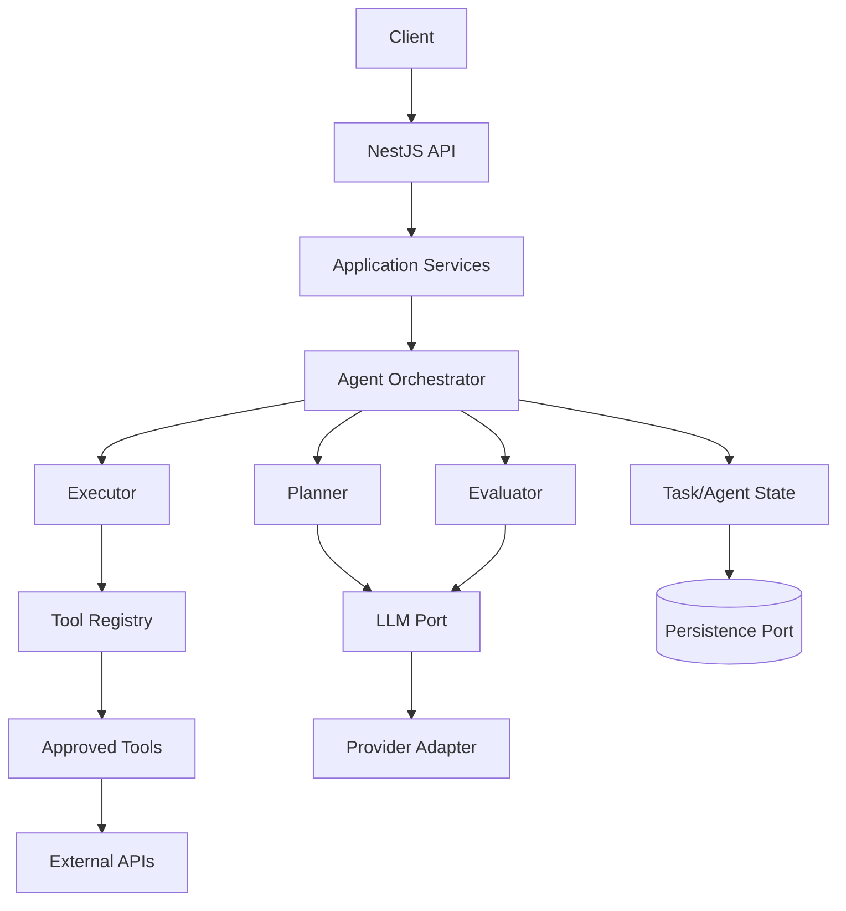

# Architecture

## 1. Architecture goals
- Make Agent behavior understandable and observable.
- Keep model-provider and tool integrations replaceable.
- Enforce backend validation, permissions, budgets, and lifecycle rules.
- Separate domain decisions from infrastructure details.
- Start modestly and evolve without a premature microservice architecture.

## 2. High-level components

## 3. Layer responsibilities
### API / Presentation
Controllers, request DTOs, response mapping, auth (later). No agent logic or tool execution in controllers.
### Application
Use cases and orchestration: create task, run task, resume task, query task, cancel task. Coordinates domain and ports.
### Domain
Entities, value objects, lifecycle rules, policy decisions, interfaces/ports. Avoid NestJS, provider SDK, database dependencies where practical.
### Infrastructure
LLM provider adapters, search/page-reader adapters, database repositories, queue adapters, external SDKs.

## 4. Initial module boundaries
- `agent`: orchestrator, loop, lifecycle, iteration/budget control
- `llm`: provider port, provider adapters, request/response normalization
- `tools`: tool contract, registry, schemas, implementations, policy checks
- `research`: research workflow, evidence/source structures, report synthesis
- `tasks`: task API, task lifecycle, task persistence/history
- `memory`: introduced in Advanced; short-term and long-term memory are distinguished
- `database`: connection, migrations, shared persistence setup
- `shared`: cross-cutting utilities only; avoid dumping domain code here

Folder boundaries may be adjusted after B01/B02 when actual dependencies become clear.

## 5. Key interfaces (conceptual)
### LLM port
Accepts normalized messages, tool definitions, model options; returns normalized response including text, structured data, and/or tool-call proposals. Provider-specific SDK types should not leak into domain/application.
### Tool contract
A tool has stable identifier, human-readable description, input schema, execution method, timeout policy, and metadata/permissions. Tool output is normalized into success or failure observation.
### Repository port
Persistence operations are defined around domain/application needs. Implementations may use a database ORM/query library; the domain should not depend on the implementation.
### Agent policy
Backend-enforced limits: allowed tools, max iterations, timeout, retries, budget, and approval requirements.

## 6. Task lifecycle
Suggested task statuses: `queued`, `running`, `waiting_for_approval`, `completed`, `failed`, `cancelled`, `paused`.
Suggested step statuses: `pending`, `running`, `completed`, `failed`, `skipped`, `retrying`.
State changes must be validated. Terminal states should not be changed casually; explicit recovery or new task semantics should be defined later.

## 7. Execution flow
1. API validates request and creates task.
2. Application initializes state and policy/budget.
3. Planner creates or updates plan.
4. Orchestrator asks model for a bounded decision, or executes the next planned step according to the current phase design.
5. Backend validates proposed tool/action against registry and policy.
6. Executor runs the tool with timeout and normalized output.
7. Observation and event are recorded; state is updated.
8. Evaluator decides complete, continue, retry, or replan.
9. Orchestrator checks budget and lifecycle constraints before another iteration.
10. Final report is created and task transitions to terminal status.

## 8. Agent loop guardrails
- Hard maximum iterations per run.
- Maximum tool calls, elapsed time, and model/token/cost budget.
- Tool-specific timeout and retry policies.
- Stop when completed, cancelled, failed, budget exhausted, or no progress detected.
- Never treat model-proposed tool names or arguments as trusted.
- Side-effecting tools require explicit policy and may require human approval.

## 9. Observability
Record structured events such as `task.created`, `plan.created`, `step.started`, `llm.requested`, `llm.responded`, `tool.selected`, `tool.started`, `tool.completed`, `tool.failed`, `evaluation.completed`, `plan.revised`, and `task.completed`.
Store decision summaries, evidence and rationale summaries—not hidden model chain-of-thought.

## 10. Persistence evolution
Basic can initially run in-memory while interfaces are designed and tested; persistent storage enters B09. Production requires durable state and checkpoint/resume. Avoid claiming resumability until state and execution semantics support it.

## 11. Architecture evolution
Basic: modular monolith.
Advanced: add memory/retrieval components without splitting services prematurely.
Production: introduce queue/workers and operational components based on load and reliability requirements. Microservices are not a default goal.
