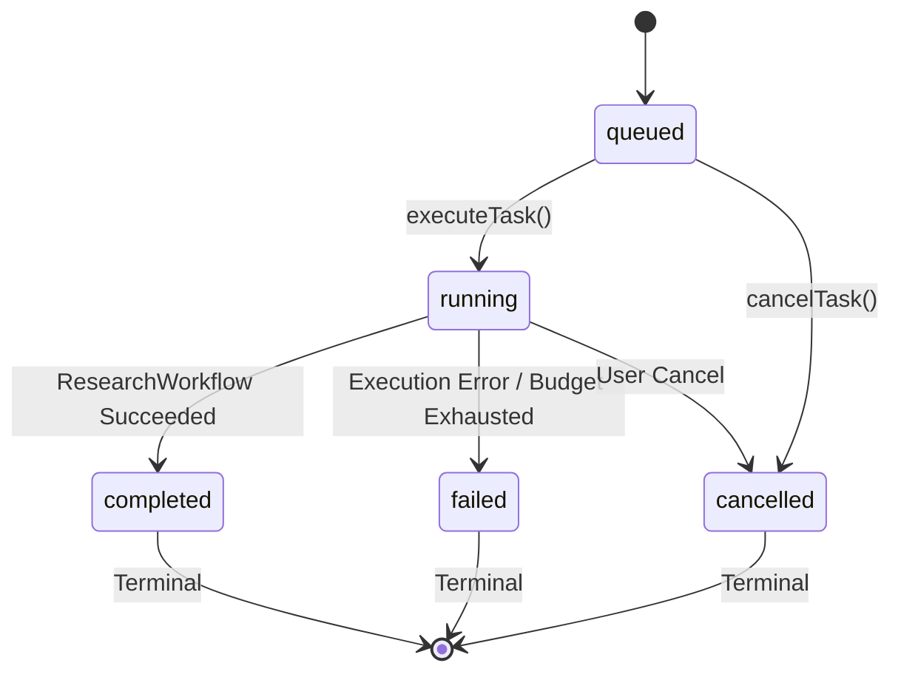

# Bài học kiến trúc B09 — Persistence & History

## 1. Mục tiêu và Thách thức cốt lõi
Một hệ thống AI Agent trong môi trường thực tế không thể chỉ là một hàm stateless chạy từ đầu đến cuối trong bộ nhớ RAM. Các tác vụ nghiên cứu thường kéo dài (hàng chục giây hoặc phút), gọi nhiều công cụ bên ngoài, và tiêu tốn ngân sách LLM token.
Các thách thức cốt lõi đối với tầng Persistence bao gồm:
1. **Tính biến thiên của Agent Payloads:** Cấu trúc kế hoạch (`Plan`), các bước (`PlanStep`), tham số công cụ (`ToolArgs`), bằng chứng nghiên cứu (`SourceEvidence`), và báo cáo (`ResearchReport`) có thể tiến hóa rất nhanh. Nếu thiết kế schema quan hệ quá cứng nhắc, mỗi thay đổi nhỏ về prompt hay tool schema sẽ dẫn tới việc phải chạy migration bảng liên tục.
2. **Tính toàn vẹn của Vòng đời Tác vụ (Task Lifecycle Invariants):** Không được phép để xảy ra tình trạng "zombie tasks" (task đang chạy bị sập server nhưng vẫn hiển thị là running), hoặc một task đã `completed`/`failed` lại vô tình bị chuyển ngược về `running`.
3. **Kiểm toán & Quan sát (Telemetry & Auditability):** Theo ADR-006, hệ thống không lưu chain-of-thought ẩn của mô hình mà lưu lại chuỗi sự kiện có thể quan sát (`AgentEvent` stream) để phục vụ debug, tái hiện lỗi và phân tích chi phí.

---

## 2. Mô hình Lai Quan hệ & JSONB (Relational + JSONB Hybrid)
Để giải quyết bài toán trên, kiến trúc persistence của KRA áp dụng mô hình lai theo **ADR-005**:
- **Các trường Quan hệ Cốt lõi (Relational Columns):**
  - `id`, `status`, `created_at`, `updated_at`, `completed_at`, `task_id`, `version`.
  - Được đánh chỉ mục (`INDEX`) để tối ưu hóa việc phân trang (`Pagination`), lọc theo trạng thái (`status = 'running'`), và sắp xếp thời gian (`created_at DESC`).
  - Đảm bảo ràng buộc khóa ngoại toàn vẹn (`REFERENCES tasks(id) ON DELETE CASCADE`).
- **Các trường Tài liệu Biến thiên (JSONB Columns):**
  - `budget_config`, `metrics`, `input_args`, `dependencies`, `payload`, `key_findings`, `sources`.
  - Cho phép lưu trữ cấu trúc đối tượng phức tạp mà vẫn có thể truy vấn sâu bằng các toán tử JSON của PostgreSQL (`->>`, `?`, `@>`).

```
┌─────────────────────────────────────────────────────────────┐
│                       Tasks Table                           │
│  id (PK) | status (IDX) | created_at (IDX) | ... | JSONB    │
└──────────────┬───────────────────────────────┬──────────────┘
               │ 1:N                           │ 1:1
               ▼                               ▼
┌─────────────────────────────┐  ┌────────────────────────────┐
│      Agent Events Table     │  │   Research Reports Table   │
│ id (PK) | event_type | JSONB│  │ id (PK) | markdown | JSONB │
└─────────────────────────────┘  └────────────────────────────┘
```

---

## 3. Kiến trúc Cổng & Bộ điều hợp (Ports & Adapters)
Tuân thủ Clean Architecture, tầng nghiệp vụ lõi (`TasksService`, `ResearchWorkflowService`) hoàn toàn độc lập với công nghệ cơ sở dữ liệu:
- **Domain Ports:**
  - `ITaskRepository`: Định nghĩa hợp đồng CRUD, lọc tìm kiếm, phân trang (`PaginatedResult<TaskEntity>`).
  - `IEventRepository`: Định nghĩa hợp đồng lưu trữ dòng sự kiện kiểm toán (`AgentEvent`).
- **Adapters:**
  - `InMemoryTaskRepository` & `InMemoryEventRepository`: Bộ nhớ in-memory kèm cơ chế deep clone để chống lỗi tham chiếu (copy-on-write / copy-on-read), phục vụ phát triển nhanh, unit test và môi trường container nhẹ.
  - `001_initial_schema.sql`: Kịch bản DDL chuẩn PostgreSQL sẵn sàng cho việc kết nối Prisma/Kysely trong các giai đoạn tiếp theo mà không làm thay đổi một dòng code nghiệp vụ nào.

---

## 4. Máy trạng thái Vòng đời Tác vụ (Task Lifecycle State Machine)
`TaskStateMachine` đóng vai trò người gác cổng (Guardrail) ngăn chặn việc chuyển đổi trạng thái bất hợp lệ:



### Các quy tắc bất biến:
1. `completed`, `failed`, và `cancelled` là **trạng thái kết thúc (terminal states)**. Bất kỳ nỗ lực nào nhằm chuyển trạng thái từ một terminal state sang trạng thái khác sẽ ném ngoại lệ `InvalidTaskStateTransitionError`.
2. Không thể chuyển trực tiếp từ `queued` sang `completed` mà bắt buộc phải qua `running`.
3. Khi chuyển sang terminal state, thời điểm `completedAt` luôn được ghi nhận chính xác.

---

## 5. Dòng Sự kiện và Khả năng Tái hiện (Event Sourcing Light)
Bằng cách lưu trữ mỗi bước thực thi, lệnh gọi công cụ, và kết quả đánh giá qua `IEventRepository`:
- Người dùng hoặc hệ thống giám sát có thể gọi `GET /api/v1/tasks/:id/events` để xem toàn bộ lịch trình thực thi từng mili-giây.
- Phục vụ việc phân tích chi phí: đếm chính xác số lượt gọi LLM (`llm.responded`), số lần chạy công cụ (`tool.dispatched`), số lần thử lại (`evaluation.completed`), và số phiên bản kế hoạch được tái cấu trúc (`plan.revised`).
